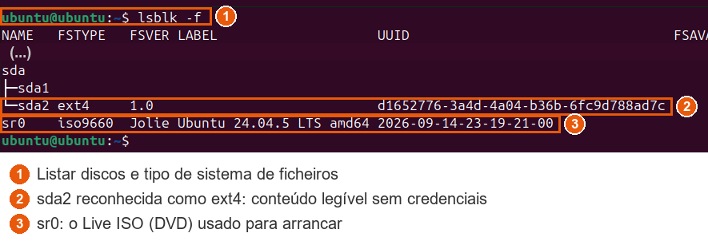
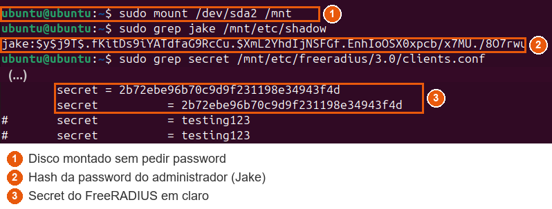
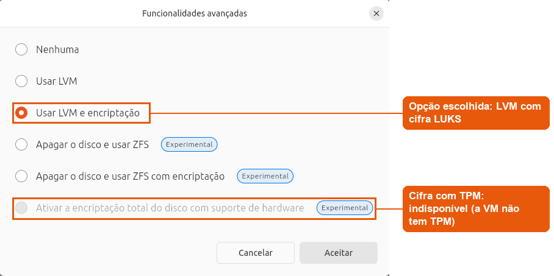
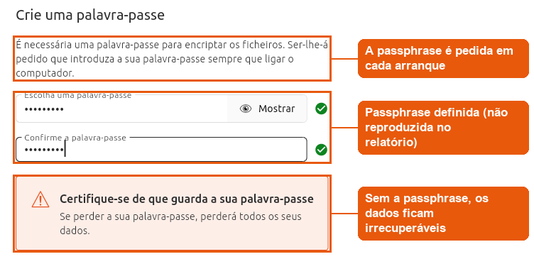
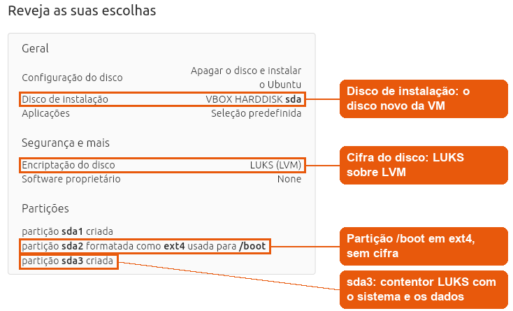
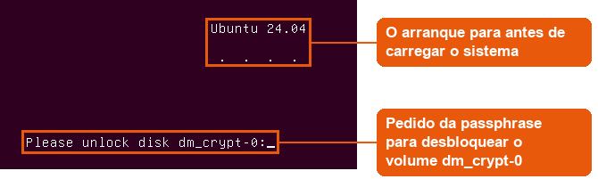
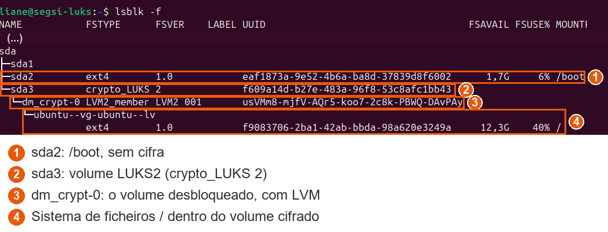
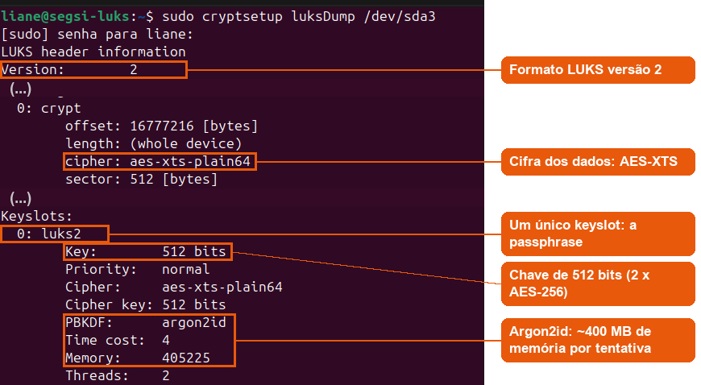
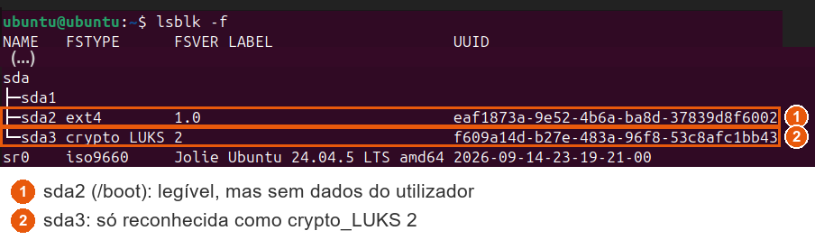
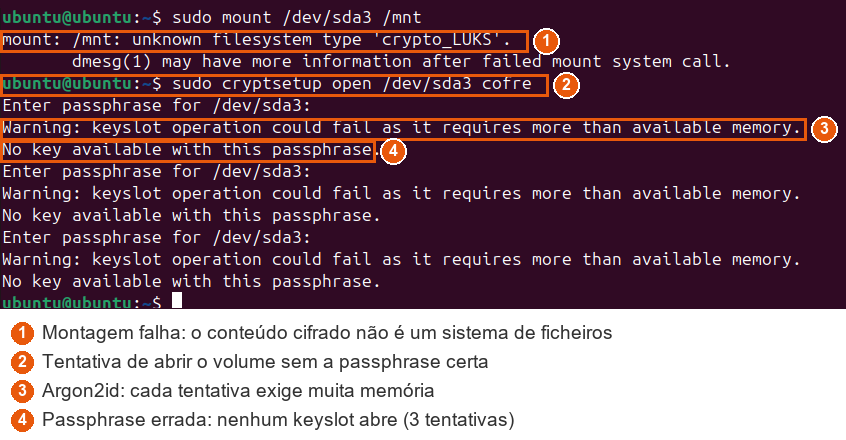

# Anexo C – PL06 Ex. 1 – Linux Disk Encryption (Liane Duarte)

> As figuras anotadas estão em `M2/relatorio/figuras-anexo/` (as capturas originais em `M2/printsExLiane/`).

O exercício pretende demonstrar que a cifra de disco protege os dados quando um atacante tem acesso físico à máquina, por exemplo depois de um roubo. Para isso, foi comparado o que um atacante consegue fazer com um Live ISO em dois discos: um sem cifra (a VM `SEGSI-M2`, usada na Opção 1) e outro cifrado com LUKS (uma VM nova, `SEGSI-LUKS`).

## C.1 LUKS

O **LUKS** (*Linux Unified Key Setup*) é o formato padrão de cifra de disco em Linux. Define a forma de guardar, no início do disco, a informação necessária para o decifrar, e usa o subsistema **dm-crypt** do *kernel* para cifrar e decifrar os dados de forma transparente: tudo o que é escrito no disco é cifrado antes de ser gravado, e tudo o que é lido é decifrado em memória. Os volumes são criados e abertos com o comando `cryptsetup`.

A estrutura de um volume LUKS tem três partes:

- **Chave mestra** (*master key*) – chave aleatória que cifra efetivamente os dados. Nunca é mostrada ao utilizador nem guardada em claro;
- **Keyslots** – até 32 posições no cabeçalho (no LUKS2), cada uma com uma cópia da chave mestra cifrada com uma credencial diferente (uma *passphrase*, um ficheiro-chave ou um dispositivo). Assim, é possível ter várias credenciais para o mesmo disco e mudar a *passphrase* sem voltar a cifrar todo o disco, porque basta reescrever um *keyslot*;
- **Cabeçalho** – contém os *keyslots*, o algoritmo de cifra e os parâmetros de derivação de chave.

No Ubuntu 24.04, os volumes são criados por omissão em **LUKS2**, com cifra **AES-XTS** (chave de 512 bits) e derivação de chave **Argon2id**. O Argon2id transforma a *passphrase* numa chave usando muito processamento e memória, o que torna os ataques de força bruta e de dicionário muito mais lentos.

O LUKS protege os **dados em repouso**, ou seja, com a máquina desligada. Não protege uma máquina ligada e desbloqueada, porque nesse estado o volume já está aberto e a chave está em memória.

## C.2 Acesso ao disco não cifrado com Live ISO

A VM `SEGSI-M2`, com o disco sem cifra, foi arrancada a partir do Live ISO do Ubuntu 24.04.5, tal como faria um atacante com uma *pen* USB. O comando `lsblk -f` mostra o disco `sda` e a partição `sda2`, reconhecida como `ext4`: o sistema do Live ISO identifica o conteúdo sem qualquer credencial.

*Figura C.1 – Discos vistos a partir do Live ISO: a partição sda2 é reconhecida como ext4*

A partição foi montada com `sudo mount /dev/sda2 /mnt`, sem ser pedida qualquer *password*: no Live ISO, o utilizador tem privilégios de administrador. A partir daí foi possível ler os ficheiros mais sensíveis do servidor, como o *hash* da *password* do administrador Jake em `/etc/shadow` e o *secret* do FreeRADIUS em `clients.conf`.

*Figura C.2 – Leitura do /etc/shadow e do secret do FreeRADIUS a partir do Live ISO*

**Resposta à pergunta 2:** consegue-se montar e ler todo o disco. As permissões do Linux (por exemplo, o `/etc/shadow` só ser legível pelo `root`) e as *passwords* dos utilizadores só são aplicadas pelo sistema instalado enquanto este está a correr. Quando a máquina arranca com outro sistema, essas proteções não têm efeito. Um atacante poderia não só ler os dados, mas também alterá-los: por exemplo, mudar a *password* do `root` ou implantar ficheiros maliciosos para elevar privilégios, como refere o enunciado. Com o *hash* do Jake poderia ainda tentar descobrir a *password* offline, e com o *secret* poderia fazer-se passar por um cliente RADIUS.

No fim, a partição foi desmontada com `sudo umount /mnt`.

## C.3 Cifra do disco

Para cifrar os discos, optou-se por criar uma VM nova (`SEGSI-LUKS`, com um disco de 25 GB) e instalar o Ubuntu 24.04.5 com a cifra ativada desde a instalação, em vez de cifrar o disco da VM `SEGSI-M2`. Cifrar um disco que já tem o sistema instalado obriga a reorganizar as partições e o arranque, com risco de perder os dados. Além disso, assim a VM da Opção 1 ficou intacta, e as duas VMs permitem comparar diretamente um disco sem cifra com um disco cifrado. Na prática, é também esta a forma recomendada: ativar a cifra na instalação.

No instalador, na opção "Apagar o disco e instalar o Ubuntu", foi escolhida a funcionalidade avançada **"Usar LVM e encriptação"**. A opção "Ativar a encriptação total do disco com suporte de hardware", que usa o TPM, aparece desativada porque a VM não tem TPM.

*Figura C.3 – Escolha de "Usar LVM e encriptação" nas funcionalidades avançadas do instalador*

Em seguida, o instalador pediu a *passphrase* do disco, que será pedida em todos os arranques. O próprio instalador avisa que, se a *passphrase* for perdida, os dados são irrecuperáveis. A *passphrase* não é reproduzida neste relatório.

*Figura C.4 – Definição da passphrase do disco*

O resumo da instalação confirma a cifra **LUKS (LVM)** e a organização do disco: `sda1` (arranque), `sda2` em `ext4` para o `/boot` e `sda3`, o contentor LUKS onde ficam o sistema e os dados.

*Figura C.5 – Resumo da instalação: encriptação do disco LUKS (LVM)*

A partição `/boot` fica **sem cifra**, porque contém o *kernel* e o programa que pede a *passphrase* no arranque, e tem de ser lida antes de o disco ser desbloqueado. Esta é uma limitação conhecida: um atacante com acesso físico pode alterar o `/boot` para capturar a *passphrase* da próxima vez que o utilizador a introduzir (ataque *evil maid*). A mitigação passa pelo Secure Boot e pelo TPM (ver C.5).

Depois da instalação, a máquina passou a parar no arranque, antes de carregar o sistema, a pedir a *passphrase* do volume `dm_crypt-0`. Só depois de introduzida a *passphrase* correta o volume é desbloqueado (`dm_crypt-0: set up successfully`) e o Ubuntu arranca.

*Figura C.6 – Pedido da passphrase no arranque, antes de carregar o sistema*

Já dentro do sistema, o `lsblk -f` mostra a estrutura do disco: a partição `sda3` é um volume `crypto_LUKS` versão 2; depois de desbloqueada, aparece como `dm_crypt-0`, que contém o LVM, e dentro deste o sistema de ficheiros `ext4` montado em `/`. A partição `sda2`, com o `/boot`, é a única sem cifra.

*Figura C.7 – Estrutura do disco cifrado com o sistema a correr*

O comando `sudo cryptsetup luksDump /dev/sda3` mostra o cabeçalho LUKS e confirma os parâmetros descritos em C.1: formato LUKS2, cifra `aes-xts-plain64` com chave de 512 bits (duas chaves AES-256, como exige o modo XTS), um único *keyslot* ocupado (a *passphrase*) e derivação de chave com Argon2id, com cerca de 400 MB de memória (`Memory: 405225` KB) e 4 iterações por tentativa. O cabeçalho é legível sem a *passphrase*: um atacante consegue saber que o disco está cifrado e com que algoritmos, mas não a chave. A segurança depende apenas do segredo da chave, e não de esconder o algoritmo (princípio de Kerckhoffs).

*Figura C.8 – Cabeçalho LUKS2 do volume sda3*

## C.4 Acesso ao disco cifrado com Live ISO

A VM `SEGSI-LUKS` foi arrancada com o mesmo Live ISO usado em C.2. O `lsblk -f` mostra a partição `sda3` apenas como `crypto_LUKS 2`, sem qualquer sistema de ficheiros reconhecível. A partição `sda2` (`/boot`) continua legível, mas só contém o *kernel* e os ficheiros de arranque.

*Figura C.9 – Disco cifrado visto a partir do Live ISO*

A tentativa de montar a partição, como em C.2, falha (`unknown filesystem type 'crypto_LUKS'`). A tentativa de abrir o volume com `cryptsetup open` e três *passphrases* erradas também falha (`No key available with this passphrase`): nenhum *keyslot* é desbloqueado. Em cada tentativa, o `cryptsetup` avisa que a operação exige mais memória do que a disponível no Live ISO: é o efeito do Argon2id, que obriga cada tentativa a usar cerca de 400 MB de memória e torna um ataque de força bruta muito mais lento e caro.

*Figura C.10 – Tentativas de montar e de abrir o volume sem a passphrase*

**Resposta à pergunta 4:** já não é possível ler os dados. Ao contrário do que aconteceu em C.2, o atacante não consegue montar o disco nem ler o `/etc/shadow`, as configurações ou os dados dos utilizadores: vê apenas que existe um volume LUKS2 e os parâmetros de cifra do cabeçalho. Sem a *passphrase*, a única alternativa seria um ataque de força bruta ou de dicionário, que o Argon2id torna impraticável se a *passphrase* for forte. Só a partição `/boot` continua legível, mas não contém dados do utilizador; o risco que resta é a sua alteração (ataque *evil maid*), referido em C.3.

## C.5 Outros métodos de desbloqueio (TPM, YubiKey, impressão digital)

**Resposta à pergunta 5:** sim, o LUKS2 suporta outras credenciais além da *passphrase*, através dos *keyslots* e de *tokens*. A ferramenta `systemd-cryptenroll` permite associar ao volume:

- **TPM 2.0** – a chave fica selada no chip TPM e só é libertada se a medição do arranque (registos PCR, por exemplo do *firmware* e do Secure Boot) corresponder à esperada. Permite desbloquear automaticamente, sem *passphrase*, apenas se o arranque não tiver sido alterado, o que mitiga o ataque *evil maid*. Pode ser combinado com um PIN (TPM + PIN), para que o roubo da máquina inteira não baste. No Ubuntu 24.04, esta opção existe no instalador como experimental ("Ativar a encriptação total do disco com suporte de hardware"), mas não estava disponível na VM por esta não ter TPM (Figura C.3);
- **YubiKey e outras chaves de segurança** – através de FIDO2 (`systemd-cryptenroll --fido2-device`) ou de PKCS#11 (*smart cards*). O desbloqueio exige a presença física da chave, opcionalmente com PIN e toque, o que dá autenticação de dois fatores: algo que se tem (a chave) e algo que se sabe (o PIN);
- **Ficheiro-chave** – um ficheiro, por exemplo numa *pen* USB, registado num *keyslot*;
- **Impressão digital** – o LUKS não suporta diretamente biometria, porque não permite derivar uma chave criptográfica estável. Pode ser usada indiretamente, através de uma chave de segurança com sensor de impressão digital (por exemplo, a YubiKey Bio), em que a impressão digital desbloqueia a chave FIDO2 e esta desbloqueia o volume.

Em todos os casos, recomenda-se manter um *keyslot* com uma *passphrase* forte ou uma chave de recuperação, guardada em local seguro, para o caso de perda ou avaria do TPM ou da chave física.

## Referências (para a secção 6)

- Red Hat – *Encrypting block devices using LUKS*, RHEL 8 Security Hardening.
- ArchWiki – *dm-crypt/Encrypting an entire system*.
- cyberciti.biz – *How to encrypt a Linux hard disk with LUKS (cryptsetup)*.
- systemd – `systemd-cryptenroll(1)`, página de manual.
