# 2. FreeRADIUS

> **RASCUNHO** – rever o texto e confirmar as figuras antes de juntar ao relatório do grupo.
> As figuras anotadas estão em `M2/relatorio/figuras/` (as capturas originais em `M2/printsM2/`).

Esta secção descreve a implementação de um serviço AAA (*Authentication, Authorization and Accounting*) com o FreeRADIUS numa máquina virtual Linux. A estrutura segue os cinco pontos do enunciado: instalação (ponto 1, secção 2.2), utilizadores e papéis (ponto 2, secção 2.3), grupos PU e NPU (ponto 3, secção 2.4), configuração e testes do FreeRADIUS (ponto 4, secções 2.5 e 2.6) e evidência dos papéis atribuídos (ponto 5, secção 2.7). A secção 2.6 inclui também o teste de *accounting*, e a 2.8 a análise de segurança.

## 2.1 Ambiente e arquitetura

*Tabela 1 – Ambiente utilizado*

| Componente | Valor |
|---|---|
| Virtualização | Oracle VirtualBox 7.2.20 |
| Máquina virtual | `SEGSI-M2` – 2 vCPU, 4 GB RAM, disco de 30,9 GB, rede NAT |
| Sistema operativo | Ubuntu 24.04.5 LTS (Desktop), totalmente atualizado |
| Servidor AAA | FreeRADIUS 3.2.5 (pacotes `freeradius` e `freeradius-utils`) |
| Cliente de teste | `radtest` e `radclient`, executados na própria VM (`127.0.0.1`) |

A imagem ISO do Ubuntu foi verificada antes da instalação: o SHA256 do ficheiro descarregado coincide com o publicado em `releases.ubuntu.com` (`4da4a0c9…88f85a7`), o que garante que a imagem não foi corrompida nem alterada. Depois da instalação, o sistema foi atualizado com `apt update && apt upgrade`. Ao longo do trabalho foram tirados *snapshots* da VM no fim de cada fase, para poder voltar a um estado conhecido em caso de erro.

## 2.2 Instalação do FreeRADIUS

O FreeRADIUS foi instalado a partir dos repositórios oficiais do Ubuntu:

```
sudo apt install -y freeradius freeradius-utils
```

O pacote `freeradius` contém o servidor e o pacote `freeradius-utils` contém as ferramentas de teste, entre elas o `radtest`. Durante a instalação foram gerados parâmetros Diffie-Hellman (usados mais tarde em métodos com TLS, como o EAP), e o serviço foi registado no `systemd` para arrancar automaticamente.

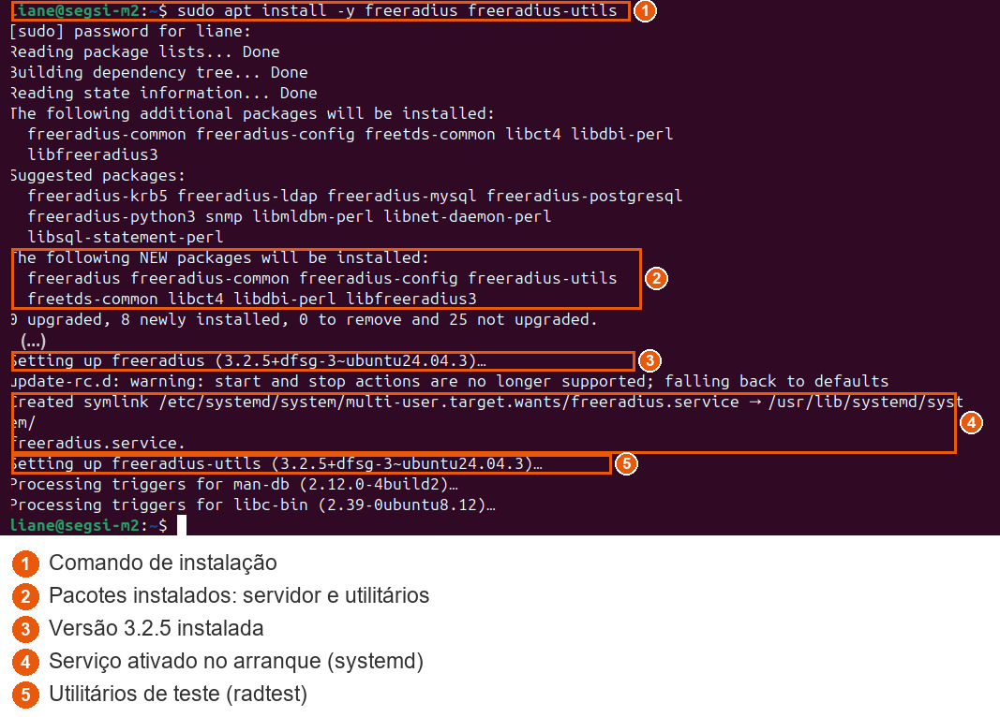

*Figura 1 – Instalação do FreeRADIUS 3.2.5*

O comando `systemctl status freeradius` confirma que o serviço está ativo (`active (running)`), configurado para arrancar com o sistema (`enabled`) e que a configuração de fábrica foi validada (`Configuration appears to be OK`). O serviço corre com o utilizador `freerad`, sem privilégios de administrador (ver secção 2.5.3).

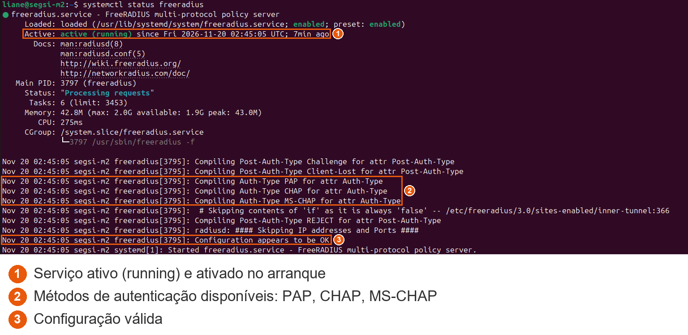

*Figura 2 – Estado do serviço FreeRADIUS*

O comando `ss -ulnp` mostra as portas UDP em que o servidor está à escuta:

*Tabela 2 – Portas usadas pelo FreeRADIUS*

| Porta | Função |
|---|---|
| 1812/UDP | Autenticação e autorização (`Access-Request` / `Access-Accept` / `Access-Reject`) |
| 1813/UDP | *Accounting* (`Accounting-Request` / `Accounting-Response`) |
| 18120/UDP (só `127.0.0.1`) | Servidor virtual interno `inner-tunnel`, usado em métodos EAP |

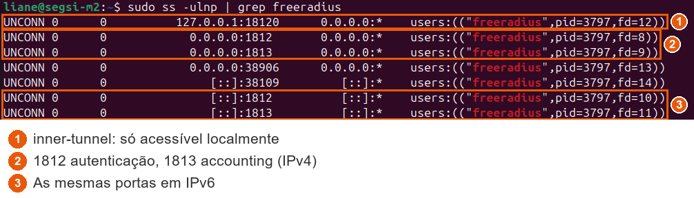

*Figura 3 – Portas 1812 e 1813 em escuta, em IPv4 e IPv6*

No RADIUS não existe uma porta própria para a autorização: a autorização é enviada na mesma resposta da autenticação, sob a forma de atributos dentro do `Access-Accept` (por exemplo, `Service-Type`). Ao contrário do TACACS+, que separa autenticação, autorização e *accounting* em trocas distintas, o RADIUS junta as duas primeiras.

## 2.3 Utilizadores e grupos do sistema

O enunciado define os papéis de quatro dos nove utilizadores: Bob e Alice são utilizadores standard, Madeleine é contabilista e Jake é o administrador ("IT Guy"). Os restantes (John, Isaac, Moses, Sara e Abraham) não têm papel atribuído neste ponto. Por isso foram criados três grupos, um por papel:

*Tabela 3 – Grupos criados no ponto 2*

| Grupo | GID | Membros | Papel |
|---|---|---|---|
| `standard` | 1001 | bob, alice | Utilizadores standard |
| `accountants` | 1002 | madeleine | Contabilidade |
| `itadmin` | 1003 | jake | Administrador |

Os utilizadores foram criados com `useradd`, com pasta pessoal (`-m`), *shell* `/bin/bash`, um comentário com o papel (`-c`) e o grupo correspondente (`-G`). Os cinco utilizadores sem papel foram criados sem grupo adicional. A Figura 4 mostra a criação dos grupos e dos utilizadores e a verificação com `getent` e `groups`.

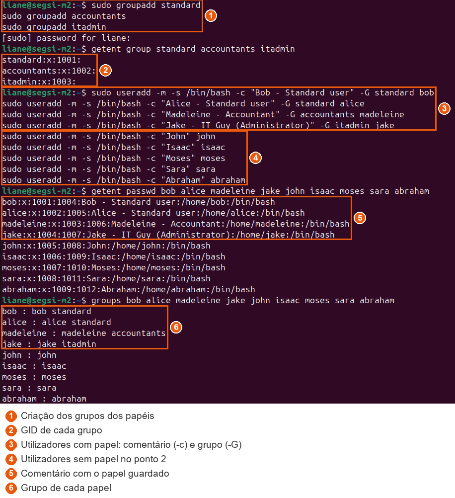

*Figura 4 – Criação dos grupos e dos utilizadores e verificação dos papéis*

### 2.3.1 Passwords e política de passwords

Numa primeira tentativa foram definidas passwords curtas e baseadas no nome (por exemplo, `bobm2`). O módulo `pam_pwquality` do Ubuntu avisou que eram fracas (`BAD PASSWORD: The password is shorter than 8 characters` e `contains the user name in some form`). Como foram definidas pelo administrador com `chpasswd`, o sistema apenas avisou e não as bloqueou.

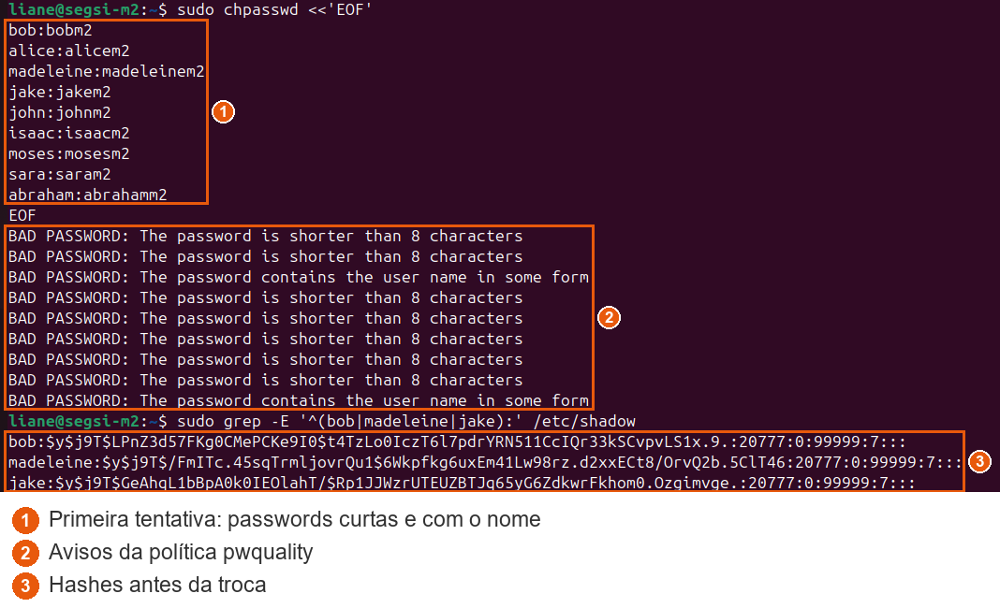

*Figura 5 – Passwords fracas, avisos da política e hashes antes da troca*

Por isso, as passwords foram substituídas por outras que cumprem a política: 10 caracteres, com maiúsculas, minúsculas, algarismos e símbolo, e sem o nome do utilizador (formato `Segsi26-NN`, em que NN é o número do utilizador). Desta vez não houve avisos. As passwords seguem um padrão previsível e servem apenas para teste. Num ambiente real, cada utilizador deveria ter uma password aleatória e única, gerida por um gestor de passwords.

As passwords não ficam guardadas em claro. O `/etc/shadow`, legível apenas pelo `root` e pelo grupo `shadow`, guarda um *hash* `yescrypt` (prefixo `$y$`) com um *salt* aleatório por utilizador. A comparação dos *hashes* antes (Figura 5) e depois da troca (Figura 6) confirma que as passwords foram alteradas: o *salt* e o *hash* de cada utilizador mudaram.

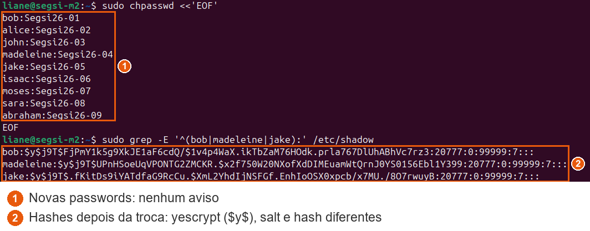

*Figura 6 – Novas passwords sem avisos e hashes depois da troca*

### 2.3.2 Privilégios do administrador

Para o papel de administrador ter efeito, o grupo `itadmin` recebeu permissão de `sudo` através de um ficheiro próprio em `/etc/sudoers.d/`, com permissões `440` e validado com `visudo -c`:

```
%itadmin ALL=(ALL:ALL) ALL
```

O comando `sudo -l -U` confirma que o Jake pode executar qualquer comando como administrador (`User jake may run the following commands: (ALL : ALL) ALL`), enquanto o Bob e a Madeleine não podem usar o `sudo` (`not allowed to run sudo`).

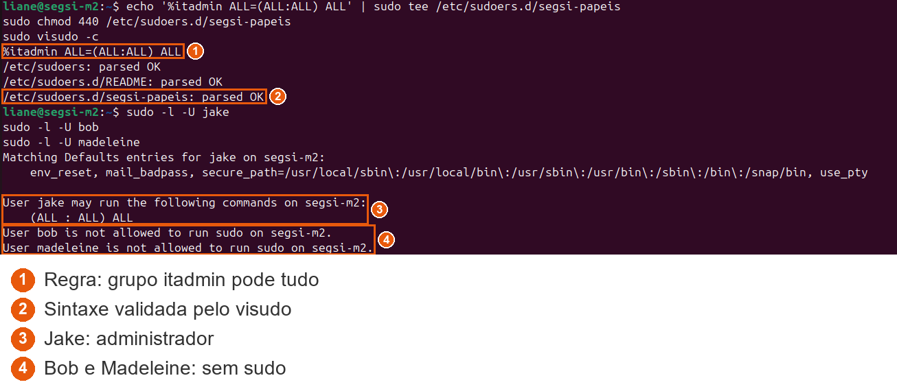

*Figura 7 – Regra de sudo para o grupo itadmin e privilégios do Jake, do Bob e da Madeleine*

### 2.3.3 Papel de contabilista

Para o papel de contabilista se distinguir do de utilizador standard, foi criada a pasta `/srv/contabilidade`, pertencente ao grupo `accountants`, com permissões `2770` (`drwxrws---`): só o dono e o grupo podem aceder, e o *bit* setgid faz com que os ficheiros criados lá dentro herdem o grupo `accountants`. O teste mostra que a Madeleine consegue criar ficheiros na pasta e que o Bob recebe `Permission denied`.

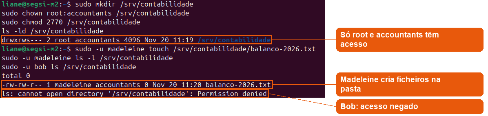

*Figura 8 – Pasta da contabilidade: acesso da Madeleine e recusa do Bob*

## 2.4 Grupos PU e NPU

Foram criados os grupos `PU` (*Privileged Users*) e `NPU` (*Non-Privileged Users*). Dos utilizadores sem papel, Isaac e Moses foram adicionados ao PU e Sara e Abraham ao NPU, com `usermod -aG` (a opção `-a` acrescenta o grupo sem remover os existentes). Conforme o enunciado, Bob, Alice, John, Madeleine e Jake não foram alterados.

O PU tem "todos os privilégios", por isso recebeu a mesma regra de `sudo` que o administrador, acrescentada ao ficheiro `/etc/sudoers.d/segsi-papeis` com `tee -a` (que acrescenta sem apagar a regra do `itadmin`) e validada com `visudo -c`. O NPU apenas pode realizar tarefas não administrativas, por isso não tem qualquer regra de `sudo`.

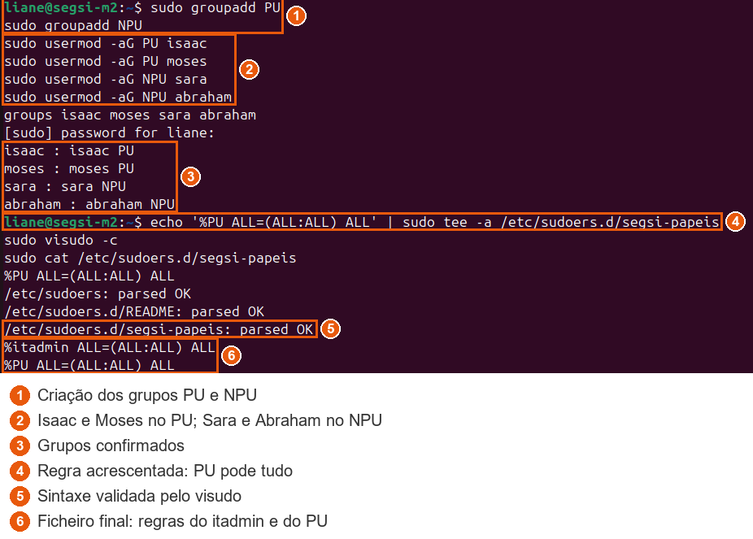

*Figura 9 – Criação dos grupos PU e NPU, atribuição dos utilizadores e regra de sudo do PU*

O comando `sudo -l -U` confirma que Isaac e Moses podem executar qualquer comando como administrador (`(ALL : ALL) ALL`) e que Sara e Abraham não podem usar o `sudo`.

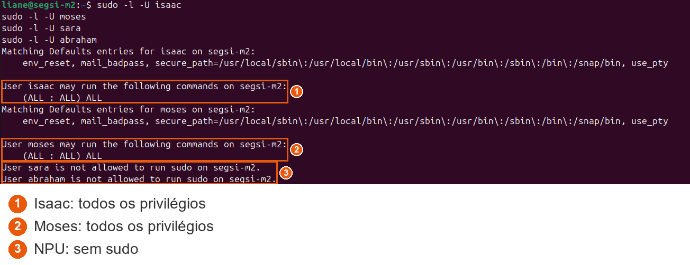

*Figura 10 – Privilégios sudo dos membros do PU e do NPU*

## 2.5 Configuração do FreeRADIUS (clientes, secret e políticas de acesso)

### 2.5.1 Interpretação do requisito

O ponto 4 pede que o FreeRADIUS aceite autenticações apenas de "*Users and the Administrator*". No enunciado, estes termos aparecem com maiúscula, como nomes de papéis. Por isso, interpretou-se "Users" como os utilizadores standard e os NPU (utilizadores sem privilégios administrativos), e "Administrator" como o administrador e os PU (que têm todos os privilégios). A Madeleine, com o papel de contabilista, e o John, sem papel atribuído, são rejeitados mesmo com a password correta. Esta interpretação permite demonstrar a diferença entre autenticação e autorização.

*Tabela 4 – Política de acesso implementada*

| Grupo | Utilizadores | Decisão | Service-Type devolvido |
|---|---|---|---|
| `itadmin` | jake | Aceitar | `Administrative-User` |
| `PU` | isaac, moses | Aceitar | `Administrative-User` |
| `standard` | bob, alice | Aceitar | `Login-User` |
| `NPU` | sara, abraham | Aceitar | `Login-User` |
| `accountants` | madeleine | Rejeitar | – |
| (nenhum) | john | Rejeitar | – |

A configuração envolveu cinco alterações, resumidas na figura seguinte e descritas nas secções 2.5.2 a 2.5.5 (secret, módulo `unix`, regras de autorização e mensagem de rejeição) e 2.6.1 (registo de autenticações).

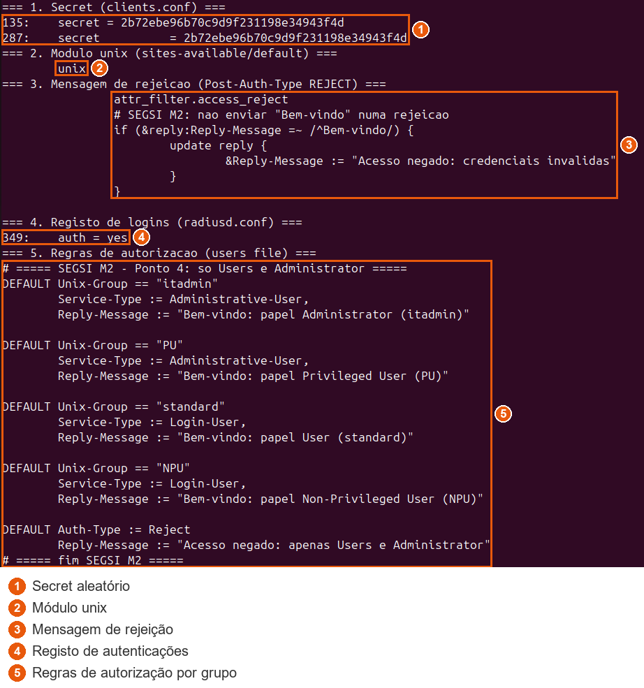

*Figura 11 – Resumo das cinco alterações à configuração do FreeRADIUS*

### 2.5.2 Secret partilhado

Cada cliente RADIUS (NAS) partilha um *secret* com o servidor, definido em `/etc/freeradius/3.0/clients.conf`. O *secret* serve para ocultar a password do utilizador no pedido (atributo `User-Password`) e para garantir a integridade e a origem das mensagens: o servidor assina as respostas (*Response Authenticator*) e ambos os lados podem assinar os pedidos e as respostas com o atributo `Message-Authenticator`. Por omissão, os clientes `localhost` (`127.0.0.1`) e `localhost_ipv6` (`::1`) vêm com o *secret* `testing123`, conhecido publicamente.

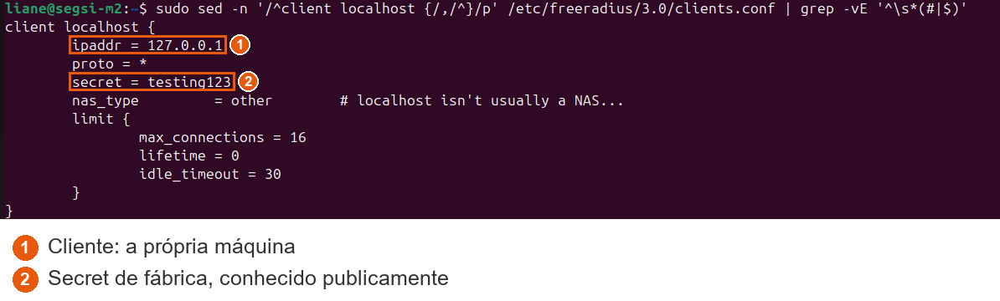

*Figura 12 – Cliente localhost com o secret de fábrica testing123*

O *secret* foi substituído nos dois clientes ativos por um valor aleatório de 128 bits, gerado com `openssl rand -hex 16`. O ficheiro original foi guardado em `clients.conf.orig`.

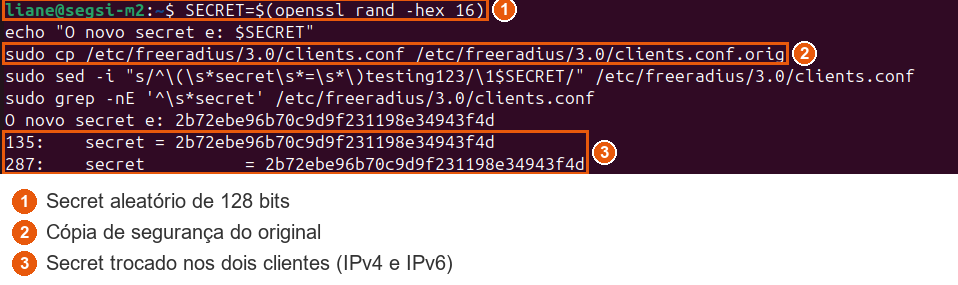

*Figura 13 – Novo secret aleatório nos clientes localhost e localhost_ipv6*

### 2.5.3 Acesso às passwords do sistema

Para validar as passwords dos utilizadores Linux, o FreeRADIUS precisa de ler os *hashes* do `/etc/shadow`. O utilizador `freerad` já pertencia ao grupo `shadow` (o pacote do Ubuntu configura-o assim), o que lhe dá apenas acesso de leitura a esse ficheiro, de acordo com o princípio do privilégio mínimo.

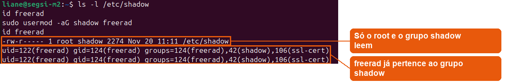

*Figura 14 – Permissões do /etc/shadow e grupos do utilizador freerad*

Foi ativado o módulo `unix` na secção `authorize` do servidor virtual `default` (linha 430 de `sites-available/default`). Este módulo obtém o *hash* da password do sistema e disponibiliza o atributo de comparação `Unix-Group`, usado nas regras de autorização.

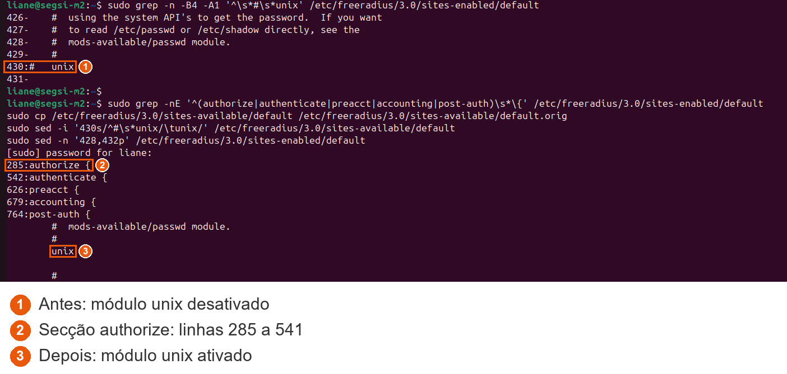

*Figura 15 – Módulo unix ativado na secção authorize*

### 2.5.4 Regras de autorização

As regras foram colocadas no início do ficheiro `mods-config/files/authorize` (o *users file*). O FreeRADIUS lê as entradas de cima para baixo e pára na primeira que corresponde ao pedido. Cada entrada `DEFAULT Unix-Group == "<grupo>"` aplica-se aos membros de um grupo Linux e define os atributos de autorização a devolver (`Service-Type` e `Reply-Message`). A última entrada, `DEFAULT Auth-Type := Reject`, rejeita todos os pedidos que não corresponderam a nenhuma regra anterior: é uma política de negação por omissão (*default deny*).

```
DEFAULT Unix-Group == "itadmin"
        Service-Type := Administrative-User,
        Reply-Message := "Bem-vindo: papel Administrator (itadmin)"
(...)
DEFAULT Auth-Type := Reject
        Reply-Message := "Acesso negado: apenas Users e Administrator"
```

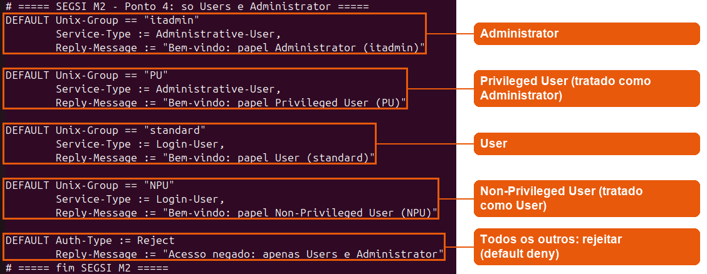

*Figura 16 – Regras de autorização no início do users file*

### 2.5.5 Mensagem de rejeição

Nos primeiros testes (ver Figura 21, na secção 2.6), um utilizador autorizado com a password errada recebia `Access-Reject` acompanhado da mensagem "Bem-vindo: papel User (standard)". Isto acontece porque a secção `authorize`, onde a mensagem é definida, corre antes da secção `authenticate`, onde a password é verificada. O filtro `attr_filter.access_reject`, já presente na configuração de fábrica, remove o `Service-Type` das rejeições, mas mantém o `Reply-Message`. Para não enviar uma mensagem enganadora, foi acrescentada à secção `Post-Auth-Type REJECT` uma regra que, quando a mensagem começa por "Bem-vindo", a substitui por "Acesso negado: credenciais invalidas". As mensagens permitem assim distinguir uma falha de autenticação (password errada) de uma falha de autorização (papel sem acesso).

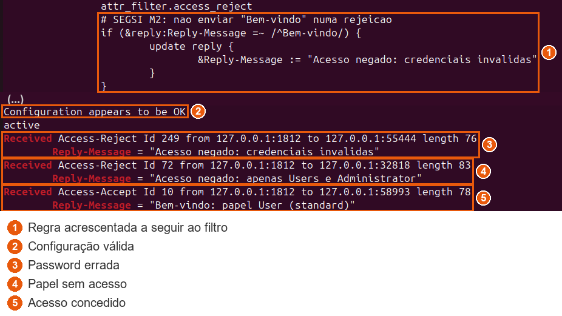

*Figura 17 – Correção da mensagem de rejeição e novos testes*

### 2.5.6 Validação da configuração

Antes de reiniciar o serviço, a configuração foi validada com `freeradius -CX`, que devolveu `Configuration appears to be OK`. O serviço foi depois reiniciado com `systemctl restart freeradius`. A mesma validação foi repetida depois da correção da secção 2.5.5 (Figura 17).

## 2.6 Testes com radtest (acessos aceites e rejeitados)

O `radtest` envia um `Access-Request` para o servidor, fazendo de cliente RADIUS. O teste do Bob com a password correta devolve `Access-Accept` com os atributos de autorização `Service-Type = Login-User` e `Reply-Message = "Bem-vindo: papel User (standard)"`. O pedido foi enviado para a porta 1812 e as duas mensagens incluem o atributo `Message-Authenticator`. No pedido, este aparece como `0x00` porque o `radtest` mostra a mensagem antes de calcular a assinatura, que é preenchida no momento do envio.

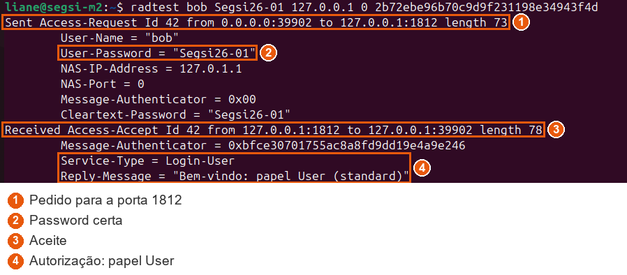

*Figura 18 – Access-Accept do Bob*

A Madeleine, com a password correta, recebe `Access-Reject` e a mensagem "Acesso negado: apenas Users e Administrator". A password está correta, mas não chega a ser verificada: como a Madeleine não pertence a nenhum grupo autorizado, a regra de negação por omissão rejeita o pedido logo na fase de autorização. A última linha (`Expected Access-Accept got Access-Reject`) é apenas o `radtest` a indicar que esperava uma aceitação.

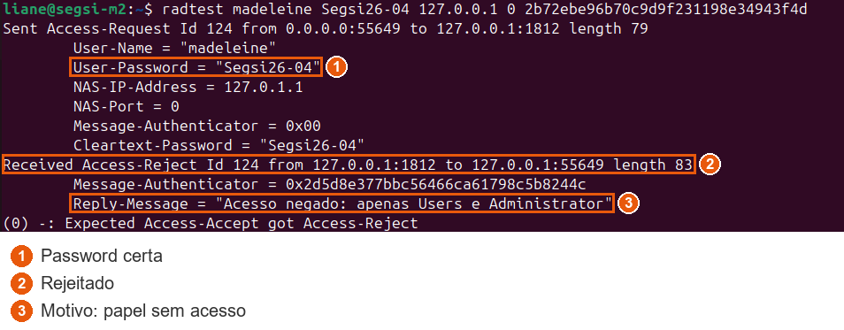

*Figura 19 – Access-Reject da Madeleine*

A figura seguinte resume os testes dos nove utilizadores, cada um com a sua password correta: sete são aceites, com o `Service-Type` correspondente ao papel, e dois (John e Madeleine) são rejeitados.

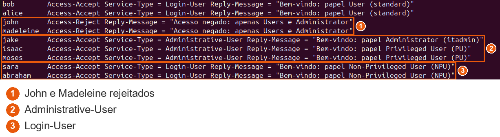

*Figura 20 – Resultado do radtest para os nove utilizadores*

Foram ainda realizados dois testes negativos:

- **Password errada** – o Bob com uma password incorreta recebe `Access-Reject`;
- **Secret errado** – um pedido com o *secret* de fábrica `testing123` não recebe qualquer resposta (`No reply from server`), apesar das três tentativas do `radtest`. Como o `Message-Authenticator` do pedido foi calculado com um *secret* diferente, a verificação falha e o servidor descarta o pedido em silêncio, sem revelar informação a um atacante.

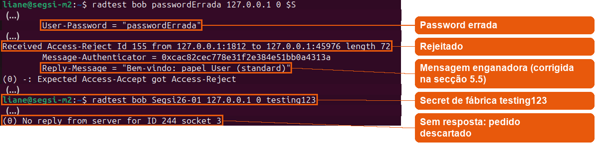

*Figura 21 – Testes com password errada e com o secret de fábrica*

### 2.6.1 Registo das autenticações

Por omissão, o FreeRADIUS não regista as tentativas de autenticação. Foi ativada a opção `auth = yes` no `radiusd.conf`, para que cada tentativa fique registada em `/var/log/freeradius/radius.log` com a data, o utilizador, o cliente e o resultado. No caso de password errada, o registo indica a causa (`Crypt digest does not match "known good" digest`), ou seja, o *hash* da password introduzida não coincide com o do `/etc/shadow`.

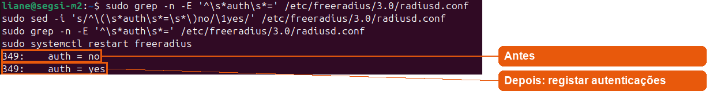

*Figura 22 – Ativação do registo de autenticações*

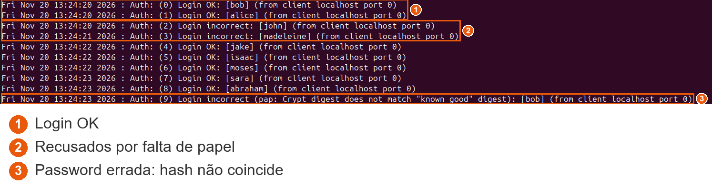

*Figura 23 – Registo das tentativas de autenticação em radius.log*

### 2.6.2 Accounting de sessões (porta 1813)

Para testar o *accounting* propriamente dito, foi simulada uma sessão do Bob com o `radclient`: um `Accounting-Request` com `Acct-Status-Type = Start` e outro com `Acct-Status-Type = Stop`, este último com a duração da sessão (120 s), o volume de dados (1 MB enviado e 5 MB recebidos pelo utilizador) e a causa de terminação (`User-Request`). O servidor respondeu com `Accounting-Response` (Figura 24) e registou as duas mensagens no ficheiro *detail* `/var/log/freeradius/radacct/127.0.0.1/detail-20261120`. O servidor acrescentou um `Acct-Unique-Session-Id`, igual nos dois registos, que liga o início e o fim da mesma sessão.

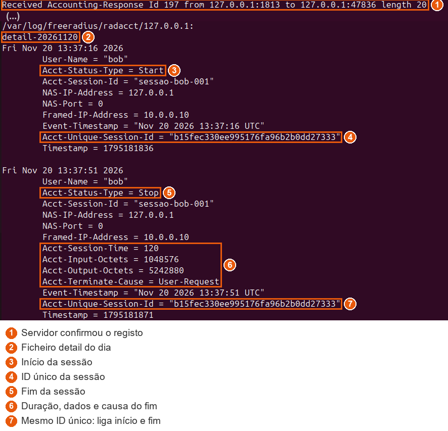

*Figura 24 – Resposta do servidor ao Accounting Stop e registo das duas mensagens no ficheiro detail*

## 2.7 Evidência dos papéis atribuídos

A Figura 25 junta, para cada utilizador, o comentário com o papel, os grupos e a permissão de `sudo`. A tabela seguinte acrescenta o resultado da autenticação RADIUS (Figura 20).

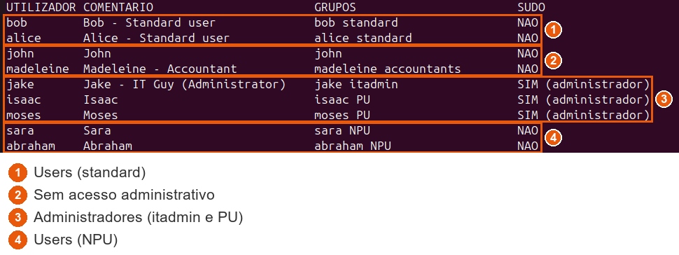

*Figura 25 – Resumo dos papéis: comentário, grupos e sudo*

*Tabela 5 – Papéis e acessos de todos os utilizadores*

<!-- larguras: 1050, 1400, 1200, 650, 950, 2050, 1204 -->
| Utilizador | Papel | Grupo | sudo | Contab. | FreeRADIUS | Figuras |
|---|---|---|---|---|---|---|
| bob | Standard user | standard | Não | Não | Accept (Login-User) | 4, 8, 18, 25 |
| alice | Standard user | standard | Não | Não | Accept (Login-User) | 4, 20, 25 |
| john | Sem papel | – | Não | Não | Reject | 4, 20, 25 |
| madeleine | Accountant | accountants | Não | **Sim** | Reject | 4, 8, 19, 25 |
| jake | Administrator | itadmin | Sim | Não | Accept (Administrative-User) | 4, 7, 20, 25 |
| isaac | Privileged User | PU | Sim | Não | Accept (Administrative-User) | 9, 10, 20, 25 |
| moses | Privileged User | PU | Sim | Não | Accept (Administrative-User) | 9, 10, 20, 25 |
| sara | Non-Privileged User | NPU | Não | Não | Accept (Login-User) | 9, 10, 20, 25 |
| abraham | Non-Privileged User | NPU | Não | Não | Accept (Login-User) | 9, 10, 20, 25 |

Na tabela, "Contab." indica o acesso à pasta da contabilidade, "Accept" e "Reject" correspondem a `Access-Accept` e `Access-Reject`, e o John não pertence a nenhum grupo de papel (apenas ao seu grupo pessoal).

O acesso à pasta da contabilidade depende das permissões `2770` do grupo `accountants` (Figura 8): foi testado para a Madeleine (acesso) e para o Bob (recusa). Para os restantes utilizadores, que não pertencem ao grupo, o resultado decorre das mesmas permissões.

## 2.8 Análise de segurança e mitigação

**Medidas aplicadas:**

- **Secret forte** – o *secret* de fábrica foi substituído por um valor aleatório de 128 bits, e os pedidos com o *secret* errado são ignorados;
- **Negação por omissão** – só os grupos explicitamente autorizados são aceites; qualquer outro utilizador é rejeitado;
- **Privilégio mínimo** – o FreeRADIUS corre com o utilizador `freerad`, com acesso apenas de leitura ao `/etc/shadow`; o `sudo` só foi concedido aos grupos `itadmin` e `PU`;
- **Passwords protegidas** – guardadas como *hashes* `yescrypt` com *salt*, e conformes com a política `pwquality`;
- **Rastreabilidade** – as autenticações e as sessões ficam registadas, o que permite auditoria e investigação de incidentes.

**Limitações e recomendações:**

- **PAP e MD5** – com PAP, a password viaja no `User-Password` ocultada com MD5 e o *secret*. Quem capturar o tráfego e descobrir o *secret* (por exemplo, por força bruta se for fraco) consegue recuperar as passwords. Em produção, recomenda-se EAP-TTLS ou PEAP, que protegem as credenciais dentro de um túnel TLS, ou o transporte RADIUS sobre TLS (RadSec, RFC 6614);
- **BlastRADIUS (CVE-2024-3596)** – o RADIUS sobre UDP é vulnerável à falsificação de respostas se o atributo `Message-Authenticator` não for obrigatório. A versão 3.2.5 do FreeRADIUS já inclui a correção, através da opção `require_message_authenticator`; recomenda-se defini-la explicitamente como `yes` em todos os clientes;
- **Tentativas repetidas de password** – o FreeRADIUS não bloqueia um utilizador após várias passwords erradas, o que permite ataques de força bruta ou de dicionário. Recomenda-se limitar as tentativas, por exemplo com o `fail2ban` a analisar o `radius.log`, ou com bloqueio de contas no PAM (`pam_faillock`);
- **Exposição de rede** – o servidor escuta em todas as interfaces (`0.0.0.0` e `::`). Neste laboratório a VM está atrás de NAT e não é acessível a partir de outras máquinas, mas num ambiente real o serviço deveria ser limitado à rede de gestão com uma *firewall*, mesmo respondendo apenas a clientes conhecidos;
- **Registo pouco detalhado** – no `radius.log`, os pedidos rejeitados por falta de papel (John e Madeleine) aparecem como `Login incorrect`, tal como uma password errada (Figura 23). Isto dificulta a auditoria, porque não permite distinguir uma tentativa de adivinhar passwords de um utilizador sem permissão. Recomenda-se registar também o motivo da rejeição (por exemplo, com o módulo `linelog` na secção `Post-Auth-Type REJECT`);
- **Passwords de teste** – as passwords usadas seguem um padrão previsível e não seriam aceitáveis num ambiente real;
- **Secret visível no relatório** – o *secret* aparece em claro em algumas figuras, por ser um ambiente de teste. Num ambiente real, o *secret* nunca deve ser divulgado nem guardado fora dos ficheiros de configuração, que devem ter acesso restrito; se for exposto, deve ser substituído em todos os clientes.

## Conclusão (texto para a secção 5)

O FreeRADIUS foi instalado e configurado para implementar as três funções AAA: a **autenticação** valida as passwords dos utilizadores Linux; a **autorização** aceita apenas os papéis User e Administrator e devolve o `Service-Type` correspondente; e o ***accounting*** regista as tentativas de autenticação e as sessões. Os testes com o `radtest` e o `radclient` confirmam o comportamento esperado para os nove utilizadores e mostram que o servidor ignora pedidos com o *secret* errado.

## Referências (para a secção 6)

- RFC 2865 – *Remote Authentication Dial In User Service (RADIUS)*.
- RFC 2866 – *RADIUS Accounting*.
- RFC 6614 – *Transport Layer Security (TLS) Encryption for RADIUS*.
- FreeRADIUS Project – documentação oficial, https://www.freeradius.org/documentation/
- BlastRADIUS (CVE-2024-3596), https://www.blastradius.fail/
